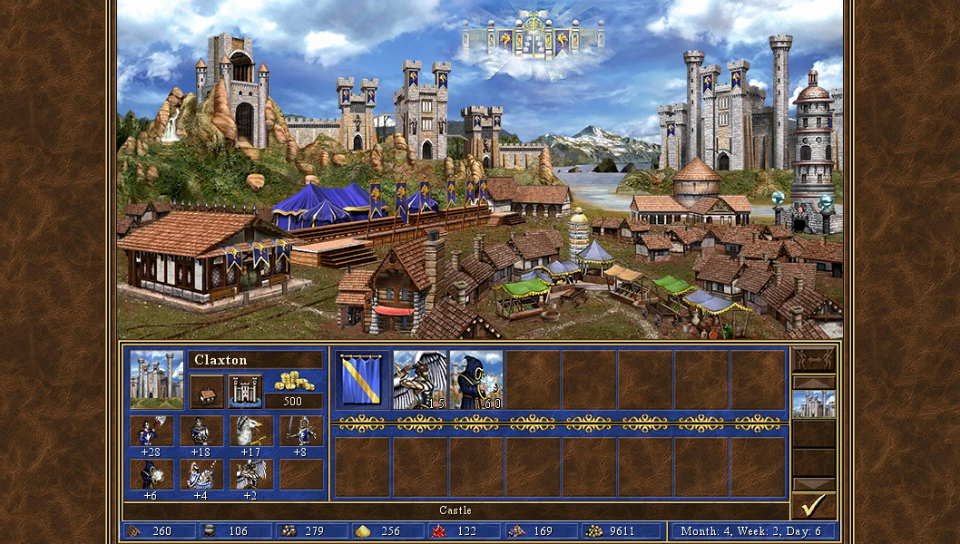

# Heroes of Might and Magic III HD Edition wrapper/port for PS Vita

<p align="center"></p>

This repository contains a loader of **the Android release of Heroes of Might and Magic III HD Edition**, based
on the [Android SO Loader by TheFloW](https://github.com/TheOfficialFloW/gtasa_vita).
The loader provides a tailored, minimalistic Android-like environment to run
the official ARMv7 game executables on PS Vita.

At the time of writing this readme, the Heroes of Might and Magic III HD Edition was delisted from the major Android storefronts. This loader ("port") is intended to be used only by those people who bought the game prior to the delisting and still can legally access their own copy through the Purchased Apps list on Google Play.

**This software does not contain the original code, executables, assets, or other
non redistributable parts of the game. The authors do not promote or condone piracy
in any way. To launch and play the game on their PS Vita device, users must provide
their own legally obtained copy of the game in the form of an .apk file.**

## Setup Instructions (For End Users)

The port has been tested only with the latest available version of the game (which is <b>v1.1.6</b>)

In order to properly install the game, you'll have to follow these steps precisely:

- Install [kubridge](https://github.com/TheOfficialFloW/kubridge/releases/) and [FdFix](https://github.com/TheOfficialFloW/FdFix/releases/) by copying `kubridge.skprx` and `fd_fix.skprx` to your taiHEN plugins folder (usually `ur0:tai`) and adding two entries to your `config.txt` under `*KERNEL`:
 
```
  *KERNEL
  ur0:tai/kubridge.skprx
  ur0:tai/fd_fix.skprx
```

**Note** Don't install fd_fix.skprx if you're using the rePatch plugin!

**Note 2** You no longer need to install ```libgpu_es4_kernel_ext.skprx``` with version 1.0.1 or higher (since it's already bundled with the game).

- <u>Legally</u> obtain your copy of Heroes of Might and Magic III HD Edition
for Android in form of an `.apk` file and `.obb` files (`main.1113.com.ubisoft.mightandmagic.heroesiii.obb` and `patch.1110.com.ubisoft.mightandmagic.heroesiii.obb` are located inside the `/sdcard/android/obb/com.ubisoft.mightandmagic.heroesiii/`) folder. [You can get all the required files directly from your phone](https://stackoverflow.com/questions/11012976/how-do-i-get-the-apk-of-an-installed-app-without-root-access) or by using any APK extractor you can find on Google Play.
- Open the `.apk` with any zip explorer (like [7-Zip](https://www.7-zip.org/)) and extract it. Copy `libhomm3.so` file (located in the lib/armeabi-v7a folder inside the apk) into `ux0:data/homm3hd/`.
- Open the `main.1113.com.ubisoft.mightandmagic.heroesiii.obb` with your zip explorer (.obb files are zip files just like .apk files so just rename the .obb to .zip) and extract the contents to `ux0:data/homm3hd/`.
- Same as before, open the `patch.1110.com.ubisoft.mightandmagic.heroesiii.obb` with the zip explorer and extract the contents inside the zip to `ux0:data/homm3hd/`.
- Install `HOMM3.vpk` (from [Releases](https://github.com/Northfear/homm3hd-vita/releases/latest)).

## Additional info

You can add custom "Restoration of Erathia" maps by copying them into `ux0:data/homm3hd/data/maps/<your_language_folder>/` folder (`ux0:data/homm3hd/data/maps/en/` for example). Note that ONLY "The Restoration of Erathia" maps are supported.

## Known Issues

- Sprites are sometimes rendered in the wrong order on the world map.

- Unit movement speed is a bit too fast during combat.

- The game can crash sometimes due to running out of vram.

- Visual bugs may appear after some time (dark UI elements, weird looking rectangles in the place of fading out UI elements). It's recommended to save the game and restart it at that point.

## Build Instructions (For Developers)

In order to build the loader, you'll need a hardfp [vitasdk](https://github.com/vitasdk) (not the softfp one that's used for other Android ports)

### Dependencies

- [PVR_PSP2](https://github.com/GrapheneCt/PVR_PSP2)

- [SDL2 fork](https://github.com/Northfear/SDL/tree/vita-2.0.9-h3hd)

```bash
mkdir build && cd build
cmake .. -DCMAKE_TOOLCHAIN_FILE=${VITASDK}/share/vita.toolchain.cmake -DCMAKE_BUILD_TYPE=Release -DVIDEO_VITA_PVR=ON
make install
```

- [pthread-embedded fork](https://github.com/bgK/pthread-embedded/tree/join-from-non-pthread)
- [kubridge](https://github.com/TheOfficialFloW/kubridge)
- [SDL_mixer](https://github.com/Northfear/SDL_mixer/tree/vita-2.0.4)
- [SDL_image](https://github.com/Northfear/SDL_image/tree/vita-2.0.5)

You may need to rebuild SDL_mixer and SDL_image manually after the installation of the required SDL2 fork.

After all these requirements are met, you can compile the loader with the following commands:

```bash
mkdir build && cd build
cmake .. && make
```

## Credits

- [TheOfficialFloW](https://github.com/TheOfficialFloW/) for the original .so loader.
- [GrapheneCt](https://github.com/GrapheneCt) for the PVR_PSP2, gpu_es4_kernel_ext and lots of tips.
- [TheOfficialFloW](https://github.com/TheOfficialFloW/), [Rinnegatamante](https://github.com/Rinnegatamante/) and [v-atamanenko](https://github.com/v-atamanenko) for all of the previous work on Android wrapper ports.
